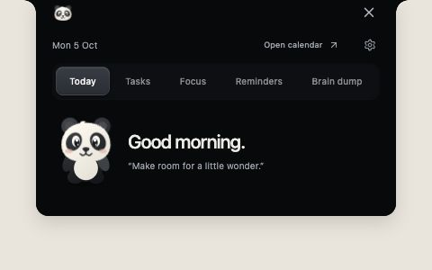

# Panda Notch



A small macOS companion that keeps tasks, focus time, and calendar reminders close at hand, with a panda named Bubu living beside the camera notch.

Designed and built by [Vansita Addanki](https://vansita.design).

## The idea

Useful reminders disappear when they live in another tab. Panda brings the next event, today's tasks, and gentle breaks into a compact panel that can expand when needed.

## What works

- Tasks with completion progress beside the panda and a panel that grows with the list.
- A focus timer, short and long breaks, and optional sound.
- Calendar access through macOS EventKit, requested explicitly by the app.
- Ideas, saved links and files, and configurable reminders.
- A native macOS shell with a React interface and animated interactions.

## Try the interface

With Node.js 22 and pnpm installed:

```sh
pnpm install --frozen-lockfile
pnpm test
pnpm exec tsc
pnpm build
python3 -m http.server 47824 --directory dist
```

Open http://localhost:47824. The browser preview uses sample events; native calendar and notch placement require the macOS app.

## Build the macOS app

On an Apple Silicon Mac running macOS 14 or later, with Xcode Command Line Tools installed, build the frontend above and then run:

```sh
zsh scripts/package.sh
```

The script creates `Panda.app` next to the repository folder. This is a development build with an ad-hoc signature, not a notarized public release. Source is provided so the app can be inspected and built locally.

## Structure

- `src/`: React interface, interaction components, and state model.
- `native/`: Swift AppKit/WebKit shell and EventKit calendar bridge.
- `tests/`: state, task-progress, and motion checks.
- `assets/audio/`: interface sounds.
- `assets/menu/`: the local Figma artwork used by the Menu cards.
- `scripts/`: frontend and native build tooling.

No personal tasks, calendar exports, or saved application data are included. See `THIRD-PARTY-NOTICES.md` and `licenses/` for dependency and component credits.

## Everyday tools

### Menu
Panda opens to **Menu**, with cards for **Task Planning**, **Focus**, **All links**, **Ideas**, and **Reminders**. Scroll sideways to reach every card, or use Tab and the arrow keys. Overflow edges fade softly, and each card has a brief individual hover response that respects reduced motion. The Task Planning card opens the **Task Plan** tab. Tabs appear after entering a feature and remain available when returning to Menu; a fresh opening starts with the compact menu alone.

### Expand the task calendar
In **Task Plan**, add your to-dos, then choose **Expand** or click a task to reveal today’s calendar beside the same list. Use the pencil to edit a task’s name. Click a task’s dot, move to the calendar, and drag from the start time to the end time. You can drag in either direction; intervals use 15-minute steps. Press Escape to cancel before saving. Connected tasks are saved in the selected writable Mac calendar. Saved tasks remain connected to their calendar blocks by gray threads; hovering or interacting highlights the connection in blue. Drag a block’s body to move it while keeping its duration, or its bottom edge to resize it. Choose **Compact** to return to the checklist with scheduled times beside task names. Click a scheduled block to change its time or color, or unlink its event while keeping the task.

### All links
The All links tab stores reusable web links and local file copies. Add a link and use Copy; add a file with the Mac file picker and drag its row into a compatible app or upload field. The file Copy button also supports pasting into Finder and other file-aware apps. Files remain on this Mac in `Application Support/Panda/Pins`; originals are never modified. Pin the file again after updating your résumé. Files are limited to 50 MB each and there are at most 200 pins. Removing a pin hides it and offers Undo; its local copy remains available for recovery. JSON exports include pin metadata, not attachment contents, so keep the Pins folder with a full backup. File selection and native file dragging are available in the Mac app; the browser preview supports links.

### Copy text from screen
Click the cursor beside the notch menu, or the menu-bar paw → **Copy text from screen…**. Drag a rectangle around the text; Escape cancels. Panda invokes macOS interactive screenshot selection directly, without the redundant full-screen permission preflight that could reject an enabled permission. macOS still controls capture access. Apple Vision recognizes the selected text locally and copies it for Command-V. No account or upload is involved; the temporary image is deleted after processing. Cancel leaves the clipboard unchanged. No window-sharing picker, continuous recording, or capture history is used.
